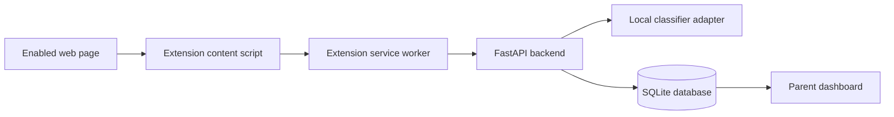

# MORVIX Demo and Code Walkthrough

This guide explains what the current MORVIX source implements and how to present its text workflow. The project contains a FastAPI backend, a parent dashboard, and a Chromium extension. The text adapter is limited to one English toxic-comment label, and this source bundle does not include its required model weights. Restore the team's approved local snapshot before demonstrating real inference; the automated tests can still verify request handling, policy decisions, and event storage with controlled test doubles.

## System architecture

The extension reads visible page text only after the site is enabled and the active policy allows text checks. The service worker authenticates with the paired device token. The backend applies the parent policy and saves supported results as event metadata. The dashboard reads account-scoped event, alert, settings, and device APIs.

## Text-analysis request flow

1. `browser_extension/content.js` collects visible text from the current page, up to 20,000 characters. It skips hidden/form-like content, checks for text changes, and avoids resending an unchanged text snapshot.
2. The content script asks `browser_extension/background.js` to analyze the text. The service worker checks site rules and modality settings before sending a request.
3. `analyzeText` in `browser_extension/background.js` sends an authenticated `POST /api/v1/extension/classify/text` request with `text`, the page origin in `source_url`, and a unique `event_key`. It validates the response. A timeout, invalid response, or backend error is shown as uncertain; the page is not falsely reported as successfully checked.
4. `TextAnalysisInput` and `analyze_text` in `backend/app/api/extension.py` reject empty/whitespace-only or oversized input. The route passes valid text into `_analyze`.
5. `_load_text_model` and `classify_text` in `backend/app/classifiers.py` load model files from the local configured path with `local_files_only=True`. The adapter normalizes text, runs overlapping token windows, applies sigmoid to model logits, and takes the maximum `threat` score across windows.
6. The model supports only the `threat_language` category in MORVIX. It maps the model's Jigsaw `threat` label to that category. The other toxic-comment labels are not separate MORVIX detections. A category name or score does not establish that the text is a real threat.
7. `_analyze` in `backend/app/api/extension.py` applies website rules before classifier inference, then checks modality and category policy. `evaluate_policy` in `backend/app/policies.py` allows scores below the review threshold. At or above review it uses the parent's Allow/Warn/Block action; a requested Block becomes Warn below the block threshold and Block at or above it. Threshold comparisons are inclusive at the boundary.
8. `record_detection` in `backend/app/events.py` writes event metadata, and creates an alert for Warn or Block. Supported classifier results are saved even when the final action is Allow. The database stores the page domain, category, confidence, action, classifier/version, policy reason/version, and UTC timestamps; it does not store the submitted text. An `event_key` makes retries idempotent for the same parent account.
9. The extension displays the returned action in `browser_extension/content.js`: Warn shows a dismissible review notice, Block shows a blocking overlay, and an unavailable check is clearly labeled uncertain while leaving the page open. The dashboard reads history from `GET /api/v1/events`, alerts from `GET /api/v1/alerts`, and overview counts from `GET /api/v1/dashboard/summary`.

## Model purpose and limits

The configured text model is `unitary/toxic-bert`, an English Jigsaw toxic-comment classifier. MORVIX exposes only its `threat` output as `threat_language`. It is not a general threat, morbid-content, graphic-violence, or self-harm classifier. In particular, a description of death, injury, gore, or animal suffering is outside its verified task, so this build must not claim to detect morbid text. The uncased model can be affected by language, profanity, identity terms, and context. The maximum score across long-page windows is an uncalibrated heuristic. A morbid-content category needs an approved model trained or evaluated for that definition and a labeled local evaluation set; no replacement model or keyword-only detector is included.

The repository code can report unavailable models clearly, but the current source bundle does not contain the text or video model snapshots. Image inference is intentionally rejected because the candidate image checkpoint has no verified class-label mapping. The video adapter is a separate experimental pipeline; it samples frames and ignores audio, and it has not been evaluated against MORVIX's target categories. Self-harm appears as a policy taxonomy entry only and has no classifier.

## Important files and functions

| File | What it does |
|---|---|
| `backend/app/main.py` | Creates the FastAPI app, mounts dashboard assets, initializes SQLite, and serves health/readiness routes. |
| `backend/app/api/extension.py` | Pairs devices, syncs policies, validates text requests, runs `_analyze`, and returns the final policy decision and event ID. |
| `backend/app/classifiers.py` | Checks model readiness, loads local weights, normalizes classifier output, and reports loading/inference failures. |
| `backend/app/policies.py` | Defines default policy values, matches website/category rules, validates thresholds, and decides Allow/Warn/Block. |
| `backend/app/events.py` | Persists metadata-only detection events and creates Warn/Block alerts. |
| `backend/app/database.py` | Defines and initializes the SQLite schema, including events, alerts, policies, devices, and rules. |
| `browser_extension/content.js` | Extracts visible text, observes page changes, shows warning/block notices, and initiates supported media checks. |
| `browser_extension/background.js` | Handles authenticated API calls, policy synchronization, text response validation, and media readiness checks. |
| `browser_extension/popup.js` | Presents connection/protection state, pairing, and per-site access controls. |
| `web_dashboard/js/app.js` | Renders dashboard, history, alerts, rules, settings, pairing, and current classifier readiness. |
| `web_dashboard/js/classifier_copy.js` | Explains classifier coverage and unavailable/experimental categories in the settings UI. |
| `data/controlled_extension_test/MORVIX_plain_text_demo.html` | Controlled page containing benign and fictional text for manual extension checks. |
| `data/controlled_extension_test/threat-only.html` | Isolated fictional threat-language sample for manual extension checks. |

## Demo sequence

1. From the project root, create a fresh Python 3.11 or 3.12 virtual environment on the laptop and install `requirements.txt`. Install `requirements-ml.txt` for the model runtime. Use a version actually installed on that laptop.
2. Obtain the team's explicitly approved model ID and exact revision/commit, then place the approved snapshot at `models/text/toxic-bert` with config, safetensors weights, and tokenizer assets. Confirm `/api/v1/health/ready` reports `ready` for text after a successful initialization; `available_unloaded` only means files and dependencies are present before first inference.
3. Start the backend with `.\.venv\Scripts\python.exe -m uvicorn backend.app.main:app --host 127.0.0.1 --port 8000`, then open `http://127.0.0.1:8000/`.
4. Register/login through the dashboard, create a one-time device pairing code, and enter it in the extension popup.
5. Start the controlled page server on port 8001 using the README command. Enable protection for `localhost` in the extension popup. The dashboard Alerts view refreshes every 10 seconds while visible, when focused, and while the user remains on that view.
6. Open `http://localhost:8001/threat-only.html`, refresh, and observe the extension notice. Inspect the API response fields `category`, `confidence`, `action`, `reason`, and `event_id`.
7. Open Detection History and Alerts in the dashboard. Confirm the saved metadata matches the response. A live Chrome end-to-end run is not confirmed by these source changes; perform and record it during the demo.

If approved model weights are not available, demonstrate the API behavior and policy/event tests instead. State that real classifier inference is unavailable in this source bundle.

## Likely teacher questions

**What does the model detect?**  
The configured text adapter uses the English Jigsaw toxic-comment `threat` label and reports it as `threat_language`. It does not detect every kind of threat or morbid content.

**Does a high score mean the system is accurate?**  
No. The score is the model output used by the policy. No MORVIX held-out evaluation set or accuracy result is included, so it must not be presented as a measured accuracy percentage.

**How does MORVIX choose Allow, Warn, or Block?**  
The backend checks a matching website rule first. Otherwise, it uses the saved category action and thresholds. Scores below review are allowed; a Block action is downgraded to Warn until the block threshold is reached.

**What does Detection History save?**  
It saves metadata such as category, confidence, action, source domain, timestamp, and policy reason. It does not save the page text. Warn and Block outcomes also create alerts.

**Does image, video, or self-harm classification work?**  
Image classification is unavailable because its candidate checkpoint has no verified label map. Video has an experimental local adapter but no MORVIX accuracy evaluation. No self-harm classifier is configured.

## Local functional checks

Run backend tests with `.\.venv\Scripts\python.exe -m pytest backend/tests -q`. They cover request validation, missing-model and inference failures, policy threshold boundaries, event persistence, privacy, rules, pairing, and dashboard APIs. `backend/tests/test_classifier_examples.py` runs four real-model smoke examples (benign, threatening, abusive, and disturbing fictional text) only when the local model is ready. It checks output shape and score bounds, not whether any text is correctly classified; it skips when dependencies or weights are missing.

Run extension and dashboard JavaScript tests with the commands in the README. These checks exercise source behavior in test environments. They do not verify a live Chrome installation, actual model accuracy, or end-to-end browser enforcement.

## Known limitations and next steps

- Restore the approved model dependency versions, exact text/video model revisions, and local snapshot files in a separate trusted setup package. `requirements-ml.txt` includes `torch`, `transformers`, and `safetensors` for text loading; readiness reports each missing package before attempting inference.
- To add morbid-text detection, first select and approve a suitable local classifier, then evaluate it on labeled examples that distinguish graphic descriptions from ordinary historical, medical, news, and fictional references. Toxic-BERT's threat output is not a substitute.
- Evaluate the text model on a labeled, held-out MORVIX dataset, including benign, abusive, explicit threats, disturbing fiction, and relevant language variants. Report measured results and false positives/negatives.
- Select a compatible image model with verifiable labels before enabling image inference.
- Decide whether a validated self-harm classifier and audio analysis belong in the approved scope.
- Run and record the controlled Chrome flow, including pairing, current policy sync, real model response, intervention, saved event, and refreshed dashboard history.
- Confirm final category definitions, thresholds, retention period, browser support, and other open decisions in the draft SRS with the adviser/team.
